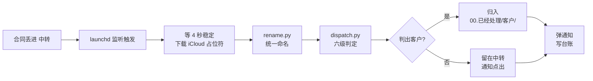

# hetong-archiver

     

合同归档与统一命名。把 `📚合同审查/中转` 里处理完的合同，按当事人主体识别客户，归入 `00.已经处理/<客户>/`，并按统一规则改名。判不出的件留在原处出清单，从不删除文件，从不覆盖。

私有仓库，两台 Mac 通过 `git pull / push` 共同管理。合同文件不进 git，留在 iCloud 的 `📚合同审查`；客户规则表放 `<root>/.合同归档/config.json`，随 iCloud 同步。

## 工作流程



## 快速开始

全自动模式（推荐，装一次即可）：

```bash
git clone https://github.com/xuezhihaoyun/hetong-archiver.git \
  ~/claude-code-项目工作区/skills/hetong-archiver
cd ~/claude-code-项目工作区/skills/hetong-archiver
bash install.sh            # 软链四端 + 生成配置 + 冒烟测试
bash install_watcher.sh    # launchd 监听中转，落文件即归档并弹通知
```

首台装完需人工授权一次「完全磁盘访问权限」（TCC 受 SIP 保护，脚本改不了），步骤见 `自动归档.md`。卸载用 `bash install_watcher.sh --uninstall`，卸载后回到手工模式。

手工模式（不走 watcher）：

```bash
cd scripts
python3 dispatch.py                  # 演练归档：出「自动分派 / 待定」两张清单
python3 rename.py "<root>/中转"      # 演练改名：出台账 CSV
# 确认无误后才加 --apply；日常对 AI 说一句「归档」即可
```

## 客户怎么判（六级，代码已实现）

| 顺位 | 依据 | 置信 |
|---|---|---|
| 1 | 合同当事人主体（甲方／乙方／出租方…抽名称比对别名） | 高 |
| 2 | 文件名 / 所在文件夹名命中客户别名 | 高 |
| 3 | 正文关键词（别名 ≥3 字才计，防「上海华加」误中「海华」） | 中 |
| 4 | `file_rules` 固定规则（人工确认过的，支持客户名／`__TEMPLATE__`／`__OTHER__`／`__DIR__:目录`） | 高 |
| 5 | 空白模板（抽不出主体＋含模板/标准版字样或 ≥3 处 `____`）→ `其他/模板库` | 自动 |
| 6 | 都不中 → 留在 `中转` 出待定清单，人点头后才动 | 人工 |

`weak: true` 的别名（如「齐心」）只提示，不触发自动移动。

## 命名规则

```
客户-合同名（标的/对方）（客户标记）-状态-版本-YYYYMMDD.扩展名
```

- 合同名照合同原文，一个字不改不漏
- 状态七词：`拟定稿-P`｜`草稿`｜`修订版`｜`审核回复`｜`批注版`｜`定稿`｜`签署版`
- 日期取件上能认出的日期，查不出就不写，不猜

## 三层配置，各放各的

| 内容 | 位置 | 为什么 |
|---|---|---|
| 脚本、文档、`config.example.json` | GitHub（本仓库） | 版本管理，两台对齐 |
| 合同文件本身 | iCloud `📚合同审查` | 客户资料，绝不进 git |
| 真实客户别名、固定规则 | `<root>/.合同归档/config.json` | 跟 iCloud 同步，两台共用一份 |
| `local.json`、`归档日志/`、`改名台账/` | 本机（已 gitignore） | 各记各的，不冲突 |

## 目录导航

| 文档 | 什么时候看 |
|---|---|
| `INSTALL-FOR-AI.md` | 把整包丢给 AI 部署时，让它先读这个 |
| `自动归档.md` | watcher 的安装、行为、授权与排查 |
| `使用说明.md` | 日常用法、加客户、沉淀规则 |
| `SKILL.md` | AI 的工作流与红线（agent 入口） |
| `references/命名规则.md` | 文件名各段的确切口径 |
| `references/归档规则.md` | 判定顺序、主体抽取、四个去向 |
| `references/客户归属备忘.md` | 已拍板的客户对应关系 |
| `排错.md` | 跑不动、判错、iCloud 相关 |
| `换机安装.md` | 手工安装步骤、多机共用说明 |
| `变更记录.md` | 版本沿革与踩过的坑 |
| `工作过程性文件/0-AI接手必读.md` | 新 agent / 新会话接手先读（门禁＋地图） |
| `工作过程性文件/工作日志.md` | 速读区＋口径卡＋流水区：当前节点与已拍板口径 |

## 红线

1. 从不删除文件；重名不覆盖，自动加后缀
2. 演练是默认模式，`--apply` 才动文件
3. 判不出客户的件留在 `中转`，不塞进「其他」凑数
4. 客户归属有歧义时问人，不猜

**一句话原则：能判就归，判不出就问人，问不出就留原地。宁可多问一句，不可归错一处。**

## 作者与授权

维护者：[xuezhihaoyun](https://github.com/xuezhihaoyun)（两台 Mac 与多个 AI 会话共同开发维护）

本仓库采用 [CC BY-NC-SA 4.0](https://creativecommons.org/licenses/by-nc-sa/4.0/deed.zh) 授权：他人可自由分享与改编，但须署名、不得用于商业目的、衍生作品须以相同协议共享。全文见 [LICENSE](LICENSE)。

合同文件、客户规则表、归档日志与改名台账属于客户资料与业务数据，不在授权范围内，一律不得分享；`config.example.json` 含真实客户名，分享前须先脱敏。
